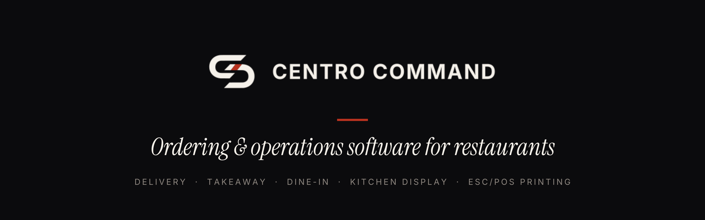

  

### Himu Sheikh · Founder, Centro Command · Rome

I build software for restaurants from the operator's side of the counter. About 15 years in food service, from order taking and the kitchen to owning a delivery and takeaway pizzeria in Rome with a team of 17.

**Centro Command** is the restaurant ordering and operations platform I built from that experience:

- Customer web ordering for delivery and takeaway: complex menus (variants, modifiers, combos, half-and-half), allergen gate, live order status
- Staff command centre and kitchen display with stations, courses and expo
- ESC/POS network printing with audited reprints and recovery after printer failure
- Stripe payments, GDPR retention and erasure, plugin lifecycle for integrations
- Dine-in module in final integration: table plans, QR ordering at the table, split bills, reservations

**Stack** · Next.js · React · TypeScript · Supabase / PostgreSQL with row-level security · CI on every change

The full source code is available for exclusive acquisition, domain included.

**[Live demo](https://demo.centrocommand.com)** · **[LinkedIn](https://www.linkedin.com/in/himusheikh)** · **founder@centrocommand.com**
